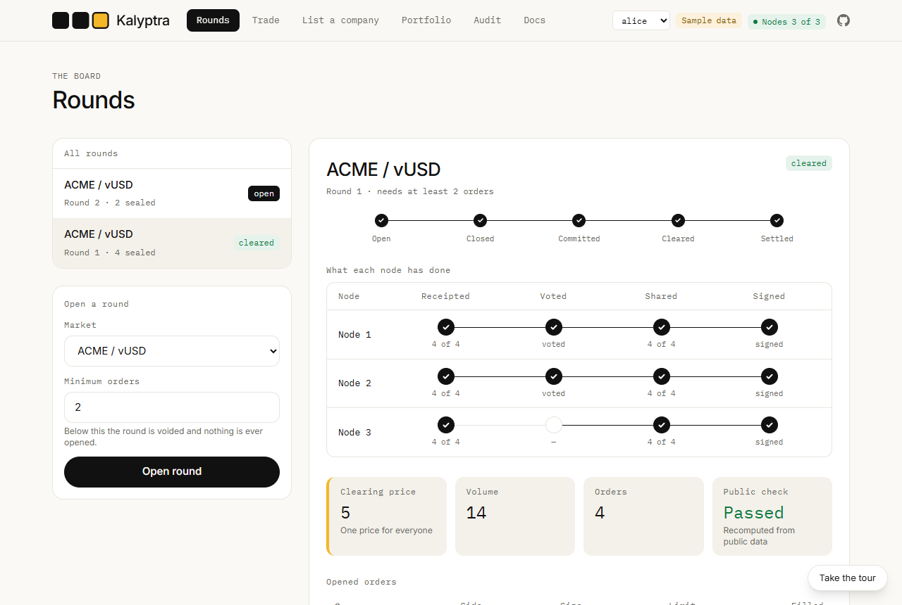
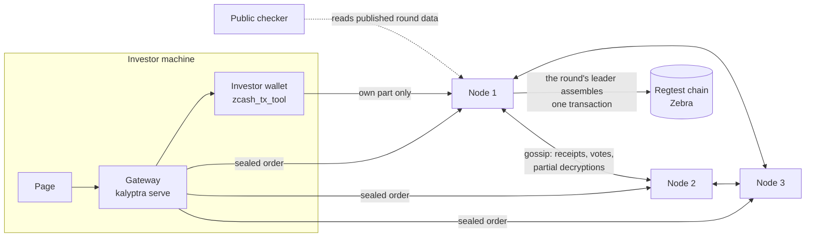

# Kalyptra

**Sealed-bid auctions for private company shares, on Zcash Shielded Assets.**

[](https://github.com/Dami904/kalyptra/actions/workflows/ci.yml)
[](#tests-and-evidence)
[](LICENSE)
[](https://kalyptra.vercel.app)
[](https://youtu.be/tFmisu23AHM)
[](Cargo.toml)
[](docs/API_NOTES.md)

> The hard part of a private market is not hiding the orders. It is hiding them *and* letting
> anyone prove the one published price is the right one.

Investors place orders that are encrypted to a key no single machine holds. When the round closes,
three matcher nodes open the orders together, clear them at **one uniform price**, and publish
enough that anyone can recompute it. A cleared round then settles as **one atomic swap**:
every filled order moves, or nothing does. Built for the Zecathon, Private Markets track.

It is a dark pool you do not have to trust: the orders stay hidden like any dark pool's, but no operator
reports the price. Anyone can recompute it.

*Sealed until close · public price · private participants · capped supply.*

[Watch the 2-minute video](https://youtu.be/tFmisu23AHM) · [Try the demo](https://kalyptra.vercel.app) · [Docs](https://kalyptra.vercel.app/docs) · [Judge fast path](#judge-fast-path) · [The proof](#the-core-proof-a-real-run) · [Privacy](#what-stays-private-and-what-is-public-by-design) · [Run it](#run-it) · [Limits](#honest-limits)

<p align="center">
  
</p>
<p align="center"><sub>A cleared round in the sample-data build: every node's progress, one clearing price, and the public check recomputed from published data. More: <a href="docs/img/landing.png">landing</a>, <a href="docs/img/portfolio.png">portfolio</a>, <a href="docs/img/docs.png">docs</a>.</sub></p>

> **Status: a working prototype on a local regtest chain. Not audited. Do not use it with real assets.**

## Try the demo

**Video (2 minutes): <https://youtu.be/tFmisu23AHM>**: the problem, the idea, and a real round on a Zcash regtest chain, from sealed orders to settlement.


https://github.com/user-attachments/assets/dd0da955-e1e6-4183-8242-464ddb2fc683


**Live: <https://kalyptra.vercel.app>**

The page has a **sample-data mode**: no nodes, no chain, nothing to install on a server. It runs the whole
round in your browser tab, with the same rules as the real system, including its refusals. A spotlight tour
(press **Show me**, or **Take the 2-minute tour** on the landing page) highlights each control in turn and moves on
when you use it:

1. **Trade:** seal an order (sell 10 ACME at a limit of 4). Two other investors have already sealed theirs.
2. **Rounds:** close the round and watch each node receipt, vote, release its share and sign.
3. **Read the result:** one clearing price (4), volume 6, and **Public check: Passed**.
4. **Settle** your order: one transaction, every order moves or none does.
5. **Portfolio:** your ACME went down by your fill and your vUSD went up by the same trade.

To see the guards, sell 500 ACME (refused: more than you hold), or place a second ACME sell in the same round
(refused: both would spend the same note). Reloading the page starts the sample over.

Run it locally with `cd ui && npm ci && VITE_USE_MOCK=true npm run dev`. The hosted copy is the same build
(`ui/vercel.json` sets `VITE_USE_MOCK=true`). Every push to `main` redeploys it automatically. The sample data is not the real system: the real one (three
nodes, a Zcash regtest chain) runs from this repository, see [Run it](#run-it).

## Judge fast path

The hosted page at **<https://kalyptra.vercel.app>** runs the sample-data demo only: settlement needs a
swap-enabled Zcash node that runs only locally (ZSA swaps are not on any public network), so the real
system is not hosted. Everything below runs on one machine.

| | |
|---|---|
| Tests | **154 passing** (`cargo test --workspace`), clippy `-D warnings`, rustfmt and rustdoc clean |
| Attacks | **15 adversarial tests, two of them 600-case randomised "a clean check means an honest result" tests**; every defence was switched off in turn and a test failed each time (23, then 28 more) |
| Independent check | 47 known-answer vectors re-derived by a separate Python and libsodium script that shares no code |
| Settlement | A real round on a regtest chain settled in **one transaction**, all balances matched |
| On a real chain | **109 rounds in a row** in random situations: 83 settled, every price, check and balance confirmed, every round verifiable offline, with the transaction ids in [`evidence/`](evidence/) |
| Under failure | **1,000 rounds** in 9 situations through three real nodes, including a node down and nodes restarted |

The shortest path (no Docker, about a minute, Linux or WSL with Rust 1.85+):

```bash
cargo test --workspace      # 154 tests
bash scripts/demo.sh        # three node processes run a whole round, then verify it offline
```

The full app (a regtest chain, wallets, the page) needs Docker and takes 15 to 20 minutes the
first time. See [Run it](#run-it).

## The core proof: a real run

The scenario: four investors seal orders, the round closes, the nodes clear it, and **anyone can
check the result from public data.** Then the saved round is verified with every node stopped,
and a copy with the price changed from 5 to 6 is rejected. This is the output of
`bash scripts/demo.sh` on 2026-10-15, trimmed for length (the full run also prints node logs):

```text
== 3. round 1: four investors submit sealed orders
round 1 open on every node (ACME/vUSD, at least 2 orders)
sealed order submitted: 3 of 3 nodes receipted it (needs 2)
sealed order submitted: 3 of 3 nodes receipted it (needs 2)
sealed order submitted: 3 of 3 nodes receipted it (needs 2)
sealed order submitted: 3 of 3 nodes receipted it (needs 2)

== 4. close; nodes commit, open the orders together, clear and sign
round 1: cleared at 5, volume 14
  order 0: buy 6 @ 5 -> filled 6
  order 1: sell 4 @ 5 -> filled 4
  order 2: sell 10 @ 4 -> filled 10
  order 3: buy 8 @ 6 -> filled 8

== 5. anyone can check the round from public data
CHECK PASSED: everything verified from public data

== 5b. save the round to a file, STOP every node, and verify the file offline
VERIFIED OFFLINE: everything checked from the file alone
tampering with the saved file (price 5 -> 6) must fail:
FINDING: RecordMismatch { field: "price" }
FINDING: RecordNotFinal
error: VERIFICATION FAILED
(rejected, as it should be)

== 6. round 2 has too few orders, so it is voided and never decrypted
round 2: voided (too few orders); nothing was decrypted
CHECK PASSED: everything verified from public data
```

Read it like this. The four orders clear at **5** for a volume of **14**: the highest volume
any single price can trade, then the least imbalance, then the lowest price. Every order that
could trade at 5 did, and the buyer who bid 6 paid 5. The checker recomputes all of that from
what the nodes published, not from anything it is told. With every node stopped, the saved file
still verifies; change one number in it and two separate findings appear, because the price no
longer matches the orders *and* the nodes never signed that record. A round with too few
orders is **voided and never opened**, so a lone order is not exposed.

### The same round, settled on a real chain

On the regtest chain (`bash scripts/run.sh`, 2026-10-15), four investors with four separate
wallets, driven through the gateway:

```text
round 1: cleared at 5, volume 14, check clean
settlement: settled, block 14, one transaction e19d96b4…432f
alice  ACME 90  vUSD 50      (sold 10 at 5)
bob    ACME 96  vUSD 20      (sold 4 at 5)
carol  ACME 6   vUSD 1970    (bought 6, paid 30)
dave   ACME 8   vUSD 1960    (bought 8, paid 40)
```

A company listed afterwards (`NOVA`, signed by 3 of 3 nodes) traded in a second round and
settled at block 17 the same way.

Every real-chain run, with what to check it against:

| Date | Run | Result |
|---|---|---|
| 2026-10-15 | `scripts/run.sh`, round 1 through the page's API | Cleared at 5, volume 14, check clean; settled in one transaction at block 14 (`e19d96b4…432f`) |
| 2026-10-15 | The same stack: `NOVA` listed by 3 of 3 nodes, then traded | Settled at block 17 |
| 2026-10-21 | A fresh run directory: `settlement/setup.sh` re-run (idempotent), then `scripts/run.sh` and round 1 again | Cleared at 5, volume 14, no findings; all four legs in one transaction at block 14 (`a2e32f79d60181d1…3617dba9`); the same four balances |
| 2026-10-21 | `scripts/soak_chain.py`: 11 rounds in different situations (refused orders, a voided round, no cross, the settlement leader down, a node restarted, a partial fill, repeats) | All 11 as expected; 9 settled in one transaction each (blocks 14 to 22), every balance reconciled after every round. Every round's bundle verifies offline, and each transaction was read back from the chain inside its block: [`evidence/2026-10-21/`](evidence/2026-10-21/), explained in [`docs/EVIDENCE.md`](docs/EVIDENCE.md) |
| 2026-10-23 | `scripts/soak_chain.py --random 98`: **109 rounds in a row** on one chain, each in a random situation (refused orders, voided rounds, ties, selling everything, the leader or another node down, nodes restarted, two companies listed mid-run and traded) | **109 of 109 as expected**: every price equal to an independent computation, every public check clean, every balance reconciled; 83 settled in one transaction each (blocks 14 to 100), all 83 found in their block by the chain's node, all 109 bundles verified offline ([`evidence/2026-10-23/`](evidence/2026-10-23/), [one line per round](evidence/2026-10-23/rounds.md)) |

## The problem

A private company's shares trade rarely and in secret. If the orders are visible, everyone
trades against what they can see. If one operator hides them, you trust that operator not to
look, not to favour someone, and not to publish a price that suits them. Kalyptra removes that
operator: no single node can read an order, drop one, or publish a price that the public check
does not reproduce.

## What was built

- **`kalyptra-tse`:** threshold sealed envelopes. An order is encrypted to a group key; any `t`
  of the `n` nodes open it after close, with proofs that each used its real share.
- **`kalyptra-matcher`:** the round state machine, the uniform-price auction, the co-signed round
  record, and the **public checker**.
- **`kalyptra-node`:** the `kalyptra` program: a node over HTTP, an investor and operator command
  line, offline verification, and a local **gateway** that serves the page.
- **`ui`:** a React page (Rounds, Trade, List a company, Portfolio, Audit). It holds no keys.
- **`settlement`:** a patch to QEDIT's `zcash_tx_tool` so each investor builds only their own part
  of one swap, and the round's leader assembles them (or the next node in turn, if the
  leader has not taken it up).

**The loop: seal, close, open together, clear, check from public data, settle atomically, audit
with a viewing key.**

## Architecture



| Module | Role |
|---|---|
| `crates/kalyptra-tse` | DKG (FROST-style), hybrid ECIES on ristretto255, DLEQ proofs, the sealer proof |
| `crates/kalyptra-matcher/src/node.rs` | One node: board, receipts, commit votes, release only after a final commit |
| `crates/kalyptra-matcher/src/checker.rs` | Recomputes a round from public data and names every finding |
| `crates/kalyptra-matcher/src/settlement.rs` | Each filled order's terms, taken from the signed record |
| `crates/kalyptra-node/src/server.rs` | A node over HTTP: gossip, rounds, settlement collection, listings |
| `crates/kalyptra-node/src/gateway.rs` | The investor's local API: tickets, funds check, wallet, listings |
| `settlement/` | The wallet-tool patch and the build script |

## How a round decides

1. **Open.** Nodes publish the round and its minimum number of orders.
2. **Submit.** An order is sealed to the group key. It is accepted once `t` nodes sign a receipt for it.
3. **Close.** Each node votes on the set of orders that `t` nodes receipted. `t` matching votes make the set final.
4. **Open together.** Only now does a node release its partial decryption, each with a proof.
5. **Clear.** Every node computes the same price; `t` of them sign the record.
6. **Check.** The checker recomputes the price and verifies every proof and signature.
7. **Settle.** Each investor builds its own part; the leader checks each part and assembles one transaction.

| Situation | Outcome |
|---|---|
| Fewer orders than the minimum | Voided: the nodes never decrypt anything |
| A node sends a wrong partial | Its proof fails, it is dropped, the round still clears |
| One node refuses a receipt | Others still receipt the order; it cannot be silently censored |
| Nodes saw different receipts at close | They vote again in a later epoch, but only once the earlier vote provably cannot win |
| `t` nodes drop a receipted order, or sign a wrong price | Not prevented; the checker proves it from published data |
| A part moves the wrong amounts | The leader names it, drops it, and its owner can replace it |
| The block is rejected, or the wallet tool gives no answer | `failed` or `unknown`, never silently "done"; the leader can retry, and the chain refuses a second spend of the same notes |

## Tests and evidence

| What | Count | What it proves |
|---|---|---|
| `kalyptra-tse` `threshold`, `dkg`, `fuzz_style`, `vectors` | 60 | Sealed envelopes, key generation, malformed input, known answers |
| `kalyptra-matcher` `rounds`, `adversarial`, `auction`, `settlement`, `order` | 70 | Whole rounds, 15 adversarial tests, the auction rules, settlement terms |
| `kalyptra-node` `http`, and two unit tests | 24 | Three real processes, the gateway, offline verification, listings, funds check, damaged files, a race, settlement retry, pages from other sites refused, a node down, a leader that never saw its round |
| `tools/check_vectors.py` | 47 vectors | A separate implementation derives the same bytes |
| [`ATTACKS.md`](ATTACKS.md) | every attack | Each attack, who stops it, and the test that proves it |
| [`docs/EVIDENCE.md`](docs/EVIDENCE.md) | 1,000 rounds, plus 109 in a row on the real chain | Nine situations (ties, no cross, too few orders, junk, duplicates, a node down or restarted) through three real nodes, then refusals, a voided round, a node down and partial fills on the chain, every balance reconciled; and the bugs those runs found, each now fixed and tested |

A passing test only means something if it can fail. Each defence was switched off, one at a time,
and a test failed each time: 23 in the first pass, then 28 more
(`bash scripts/mutate-new.sh`). Both passes found defences with no test that broke exactly that
rule; each now has one.

## Engineering decisions

- **A node can vote again only when the earlier vote provably cannot win.** The largest group of
  matching votes plus every vote not yet seen must be below `t`. Votes only add up, so that stays
  true, and two sets can never both become final.
- **`2t > n` is enforced.** Otherwise two conflicting commits could both gather `t` votes.
- **Settlement terms come only from the signed record.** The leader cannot change a price or size.
- **Each investor builds its own part.** The leader holds none of their keys.
- **One-time keys per order.** The published, opened order names no one.
- **The checker is a separate, pure function** of public data, so it can run offline.
- **The gateway never sends ticket keys to the page** and listens on loopback only.
- **A buy is costed at size times limit.** The price is never above the limit, so that is the most
  it can cost; the funds check counts what an investor's other open orders already commit.

## What is staged, and what is real

Written so a reviewer can tell a proof from a claim.

- **Real, and run end to end:** key generation, sealing, receipts, voting, opening, clearing,
  the public check, and the on-chain settlement on QEDIT's ZSA regtest node. The numbers above
  are from runs on 2026-10-15, 2026-10-21 and 2026-10-23.
- **Real, but on one machine:** the three nodes are three processes on one machine, run by one
  operator, and the four investors are four wallets behind one gateway (the page's "Acting as"
  switch). That shows the mechanism, not three independent operators: two nodes on one
  operator's machine can read orders early, which is exactly the threshold.
- **Simulated:** the chain is a throwaway local regtest chain; ACME, BOLT and CRUX are issued
  by us; vUSD is play money with no peg. The hosted demo is sample data in the browser, with no
  nodes or chain. The automated gateway tests use a stand-in for the wallet tool; the real
  wallet commands run in `scripts/demo-settle.sh` and `scripts/run.sh`, by hand.
- **Not done:** nodes with separate operators, a public network (ZSA swaps are not on one yet),
  and an audit.

## What the page shows

| Screen | Shows |
|---|---|
| Landing | What this is, the private-versus-open-book comparison, who sees what, what is live |
| Rounds | Open, close and inspect rounds; what each node has done; the check result; settle |
| Trade | Place a sealed order; your own tickets, kept on your machine |
| List a company | Issue a token, cap its supply, and have the nodes sign the listing |
| Portfolio | Your balances, read from your own wallet |
| Audit | An investor's viewing key shows their holdings to an auditor, read-only |

## What stays private, and what is public by design

| | Who can see it |
|---|---|
| **Who placed an order** | Nobody. Every order is signed with its own fresh one-time key, so nothing links it to a person, a wallet or another order. |
| **An order before the round closes** | Nobody, including the nodes. It is encrypted to a key no single node holds; opening needs 2 of 3 nodes, and they open only after signing the same final set. |
| **Holdings and transfers** | Shielded on chain. Only an auditor an investor chooses, holding their viewing key, can see that investor's holdings, and cannot spend them. |
| **Each order after the close: side, size, limit** | Everyone, anonymously. This is what lets anyone recheck the price instead of trusting the nodes. |
| **The clearing price and volume** | Everyone. One price for the whole round. |

**The trust assumption:** privacy before the close holds while fewer than 2 of the 3 nodes
collude. If 2 collude they could open orders early; even then they cannot forge the price, drop a
receipted order or wrongly void a round without the public checker proving it.

## Honest limits

The full list is in [`docs/LIMITATIONS.md`](docs/LIMITATIONS.md) and
[`docs/THREAT_MODEL.md`](docs/THREAT_MODEL.md). The headlines:

- **Local regtest only.** ZSA swaps are not on any public network yet, so settlement runs on
  QEDIT's prototype node locally.
- **One operator in the demo.** All three nodes run on one machine, so the demo shows the
  mechanism; real use puts each node with a different operator.
- **Not audited.** The threshold-decryption design is our own composition of standard parts. An AI
  review found one high-severity flaw, since fixed; there has been no human audit.
- **A wallet can settle one order per asset per round.** Found by running it for real; the
  gateway refuses the second such order. A failed or unknown settlement can be retried safely.
- **The gateway is a local program.** Plain HTTP with no login, so it only listens on
  `127.0.0.1`, on the investor's own machine. It also refuses requests from other sites' pages
  in that machine's browser (by `Origin` and `Host`), so a web page cannot read open orders or
  place one. The "Acting as" switch is a demo convenience: a real gateway holds one investor's
  wallet.
- **Rounds are periodic, not continuous.** That rhythm is the trade-off for one fair price.

## Tech stack

- **Cryptography (Rust 1.85+):** curve25519-dalek (ristretto255), ed25519-dalek, ChaCha20-Poly1305, HKDF, SHA-2
- **Nodes and gateway:** tiny_http, ureq, serde
- **Page:** React 19, Vite 8, Tailwind 4, TypeScript, react-router; fonts via Fontsource (Inter, IBM Plex Mono, Instrument Serif)
- **Chain:** QEDIT's swap-enabled Zebra regtest node and `zcash_tx_tool`, pinned to commits `0aef55c` and `a344fde`
- **Checks:** libsodium (through Python ctypes) for the independent vector check

## Project layout

```text
crates/
  kalyptra-tse/       threshold sealed envelopes, test vectors (tests/vectors/v3.txt)
  kalyptra-matcher/   rounds, auction, public checker, settlement terms, attack tests
  kalyptra-node/      the `kalyptra` binary: node, client, gateway, offline verify
settlement/           wallet-tool patch for QEDIT's zcash_tx_tool, setup.sh
scripts/              run.sh (whole app), demo.sh, demo-settle.sh, demo-ui.sh, soak_chain.py (rounds on the real chain),
                      mutate-new.sh, guardrails.sh
tools/                check_vectors.py (independent vector check)
ui/                   the page
docs/                 THREAT_MODEL, LIMITATIONS, API_NOTES, ACCESS_CONTROL, EVIDENCE, RUNOFSHOW (the demo script)
evidence/             the real-chain runs: one folder per run, with transaction ids, saved rounds and a README
spike/g0-swaps/       the first swap experiments (keeps the old name "Vibru" as evidence)
ATTACKS.md  PLAN.md   attack catalogue; design, progress and decisions
.github/workflows/    CI (all jobs green on GitHub, 2026-10-25)
```

## Run it

The step-by-step guide, with Windows (WSL) setup, your first round, checking a round yourself, running many rounds on the chain and what to do when something goes wrong: **[Run the real system](https://kalyptra.vercel.app/docs/run-the-real-system)**.

```bash
bash settlement/setup.sh   # once: builds the Zebra image and the patched wallet tool (30-70 min; most of it compiles Zebra)
bash scripts/run.sh        # the whole app: chain, wallets, assets, three nodes, gateway
```

Needs Docker, Rust 1.85+, Node 20.19+, a C compiler and about 20 GB of free disk, in Linux or WSL (the guide linked above lists every package). Then open <http://127.0.0.1:8787>. The
header has an **Acting as** switch (alice, bob, carol, dave, issuer), and a first round is open.
Startup takes 15 to 20 minutes because every wallet command rescans the chain. Ctrl-C stops
everything.

Lighter options:

```bash
bash scripts/demo.sh         # protocol only: three nodes, a round, offline verification
bash scripts/demo-ui.sh      # nodes and gateway with no chain: rounds and orders work
bash scripts/demo-settle.sh  # a round settled on regtest, with balances checked and an audit
```

The page alone, with sample data and no backend: `cd ui && npm ci && VITE_USE_MOCK=true npm run dev`.

## Tests

```bash
cargo fmt --all -- --check
cargo clippy --workspace --all-targets -- -D warnings
cargo test --workspace
python3 tools/check_vectors.py      # needs libsodium (libsodium23 on Debian and Ubuntu)
bash scripts/mutate-new.sh          # each newer defence must have a test that notices its removal
bash scripts/guardrails.sh          # repo rules as code: loopback-only URLs, no .env or keystore, no mainnet
cd ui && npm ci && npm run build     # typecheck, then build
```

The gateway tests use a stand-in for the wallet tool, so they run without a chain. Nothing in
the matcher, the checker or the nodes is faked: those tests run real nodes and real proofs.

## Attribution

- [QEDIT](https://github.com/QED-it): the swap-enabled Zebra branch and `zcash_tx_tool`, which our
  wallet commands patch. Their repository has no LICENSE file yet; their README says MIT.
- [Zcash Foundation Zebra](https://github.com/ZcashFoundation/zebra), the node QEDIT's branch builds on.
- [curve25519-dalek and ed25519-dalek](https://github.com/dalek-cryptography/curve25519-dalek) (BSD-3-Clause), and
  RustCrypto's ChaCha20-Poly1305, HKDF and SHA-2.
- React, Vite and Tailwind CSS (MIT); Inter, IBM Plex Mono and Instrument Serif through Fontsource (OFL).
- Built with AI assistance: this project was written with Claude Code (Anthropic), and the
  threshold-decryption design also had an AI security review. Neither is a human audit.

## Licence

MIT, see [`LICENSE`](LICENSE).
